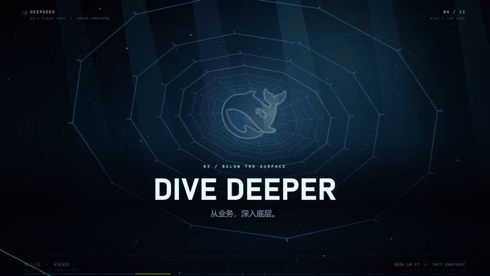

# HTML 视频制作器 · HTML Video Creator

<div align="center">
  <a href="README.md">中文</a> · <b>English</b>
</div>

<p align="center">
  
</p>

> **Make videos with HTML: review them in a browser, then confirm before exporting MP4 frame by frame.**
> An AI agent skill that combines creative briefing, timeline animation, audiovisual timing, and export verification.

[](LICENSE)

[](examples/deepseek-flash-4.1-1017-abyss/demo.mp4)

**DeepSeek abyss demo: 60 seconds · 1920×1080 · 60fps · original soundtrack.** The image above is a silent excerpt.

[Full video with audio](examples/deepseek-flash-4.1-1017-abyss/demo.mp4) · [Download MP4](https://github.com/AFAP/html-to-video/raw/refs/heads/main/examples/deepseek-flash-4.1-1017-abyss/demo.mp4) · [Example source](examples/deepseek-flash-4.1-1017-abyss) · [Storyboard and content notes](examples/deepseek-flash-4.1-1017-abyss/sources.md)

## 1. What it solves

Make an HTML animation play in a browser and export reliably to video. Playback, seeking, and export share `render(t)`, so you only maintain one storyboard.

```text
Brief and assets → Storyboard and timeline → HTML project
                                             ↓
                                Play / pause / seek → Revise and preview again
                                             ↓ User approves the result
                                PNG frames + audio → MP4 → Verification
```

## 2. Features

- ✅ Clarify audience, duration, format, pacing, style, palette, and audio with a short creative brief.
- ✅ Open HTML directly, with playback, pause, seeking, replay, and fullscreen controls.
- ✅ Use DOM/CSS, SVG, Canvas, or a combination; compute each frame from absolute time.
- ✅ Support `1920×1080` landscape and `1080×1920` portrait, one requested format at a time.
- ✅ Share visual, music, and caption cues; use the same soundtrack for preview and export.
- ✅ Check and deliver the HTML preview first; run smoke export and full verification after user approval.
- ✅ Preview without FFmpeg; let the agent prepare export dependencies after approval. No npm packages are required.

## 3. Directory structure

```text
html-to-video/
├── SKILL.md                 # Skill entry point and production instructions
├── brand/                   # Monochrome wordmarks and color square icons
├── templates/               # Directly playable project template
├── scripts/                 # Initialize, check, export, and verify
├── references/              # Rendering, audio, and troubleshooting
├── examples/
│   └── deepseek-flash-4.1-1017-abyss/  # Source, soundtrack, MP4, and preview GIF
├── tests/                   # Tool checks
├── README.md                # Chinese guide
├── README.en.md             # English guide
└── LICENSE                  # MIT license
```

Keep generated output in `output/` and dependency caches in `.cache/`. These directories and other local examples are excluded from Git. The included `demo.mp4` and `preview.gif` are demonstration assets.

## 4. Quick start

```bash
git clone https://github.com/AFAP/html-to-video.git
cd html-to-video
```

Import the complete directory into an agent platform that supports `SKILL.md`, then start with the [skill instructions](SKILL.md). To watch the example, download the repository and open `examples/deepseek-flash-4.1-1017-abyss/index.html`. HTML playback only needs a browser.

Initialization needs Node.js ≥22; automated HTML checks also need Chrome/Edge. Let the user review the HTML first. After export approval, check FFmpeg and ffprobe:

```bash
node scripts/doctor.mjs
```

If FFmpeg or ffprobe is missing, follow [environment setup](references/troubleshooting.md#环境) to locate or prepare a portable build, then rerun the check.

## 5. Create and export

Run these commands from the repository root.

```bash
node scripts/init.mjs my-video --format landscape --fps 30 --duration 30
node scripts/check.mjs my-video --format landscape --out output/my-preview
```

Edit `my-video/project.js`, add local assets, and inspect `sheet.png` and `check-report.json`. Give the user `my-video/index.html` to open, play, pause, seek, and listen. **Stop here and wait for approval of the actual result.** Apply requested changes to HTML and preview again. An HTML-only request is complete at this stage.

After the user approves the current HTML, check export dependencies and run the following commands. Continue to the full export once the two-second smoke export passes:

```bash
node scripts/doctor.mjs
node scripts/export.mjs my-video --format landscape --smoke --out output/my-smoke
node scripts/export.mjs my-video --format landscape --out output/my-film
node scripts/verify.mjs output/my-film
```

Use a fresh `--out` directory each time. Deliver the source project and MP4 after `render.json` reports `status: complete` and `smoke: false`, `verify-report.json` reports `ok: true`, and playback has been reviewed. If the user has already reviewed and approved the current HTML, proceed directly to export.

For portrait projects, replace `--format landscape` with `--format portrait` in initialization, checking, and export commands. Create only the selected format; another format needs its own layout and verification.

## 6. Configuration

| Setting | Default | Usage |
| --- | --- | --- |
| `--format` | `landscape` | Select landscape or `portrait` |
| `--fps` | `30` | Initial frame rate: `24/25/30/50/60` |
| `--duration` | `8` seconds | Initial duration; edit `project.js` afterward |
| `--crf` / `--preset` | `18` / `medium` | Set MP4 encoding quality and speed |
| `--silent` | Off | Explicitly export without audio |
| `CHROME_PATH` | Auto-detected | Path to the Chrome/Edge executable |
| `FFMPEG` / `FFPROBE` | Auto-detected | Paths to FFmpeg and ffprobe executables |
| `HTML_VIDEO_FFMPEG_DIR` | Auto-detected | Directory containing the FFmpeg binaries |

## 7. Troubleshooting

| Symptom | Action |
| --- | --- |
| Blank first frame or missing resources | Check relative paths, script order, and browser errors |
| Seeking changes the same frame | Use absolute time, seeded randomness, and clean drawing state |
| Soundtrack changes are missing | Rebuild the file referenced by `audio.src`, preview again, and export after user approval |
| Browser or encoder is unavailable | Run `doctor` and prepare dependencies using the setup guide |
| Export stops or the output directory is not empty | Keep the reports, fix the cause, and use a fresh output directory |

See [environment and troubleshooting](references/troubleshooting.md) for full instructions.

## 8. Safety and assets

The tools launch a dedicated temporary browser with its debugging port bound to `127.0.0.1`; they do not connect to your everyday browser. Include required images, fonts, and audio in the project. Review custom scripts before running them, and keep credentials, private data, and local configuration out of the project.

The model introduction is an independent example. The DeepSeek name and whale mark belong to their respective rights holders. See the [example notes](examples/deepseek-flash-4.1-1017-abyss/sources.md#官方鲸鱼标志) and the [upstream license](examples/deepseek-flash-4.1-1017-abyss/assets/deepseek-harness-LICENSE.txt) for the graphic code.

## 9. Development and validation

```bash
node --test tests/pipeline.test.mjs
```

The runtime handles playback and seeking, project scripts draw the frames, and command-line tools capture, encode, and verify the result. Shared modules use `scripts/lib-*.mjs` names alongside the command scripts. After changing tools or templates, run the tests, `check`, and a two-second smoke export for the selected format. This JavaScript project runs directly from source without a compilation step.

## 10. Documentation

- [Skill entry point and production instructions](SKILL.md)
- [Time-driven rendering interface](references/rendering-contract.md)
- [Audio, voiceover, and captions](references/audio.md)
- [Environment and troubleshooting](references/troubleshooting.md)

### Brand assets


[Monochrome wordmark](brand/wordmark.png) · [Transparent wordmark](brand/wordmark-transparent.png)

Square icons with transparent backgrounds: [Purple-blue](brand/icon-purple-blue.png) · [Orange-coral](brand/icon-orange-coral.png) · [Teal-mint](brand/icon-teal-mint.png) · [Electric blue](brand/icon-electric-blue.png) · [Magenta-violet](brand/icon-magenta-violet.png) · [Amber-gold](brand/icon-amber-gold.png) · [Graphite-lime](brand/icon-graphite-lime.png).

## 11. License

[MIT](LICENSE) © 2026 AFAP. Third-party assets and trademarks remain subject to their own licenses and usage conditions.
