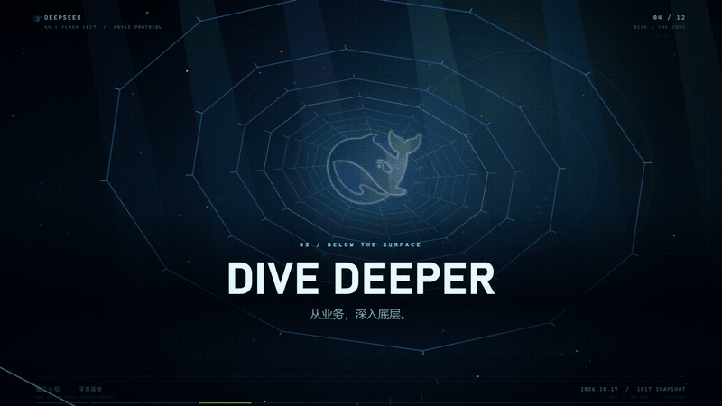

# HTML 视频制作器 · HTML Video Creator

<div align="center">
  <a href="README.md">中文</a> · <b>English</b>
</div>

> **Make videos with HTML: open them in a browser and export MP4 frame by frame.**
> An AI agent skill that combines creative briefing, timeline animation, audiovisual timing, and export verification.

[](LICENSE)

[](examples/deepseek-flash-4.1-1017-abyss/demo.mp4)

**DeepSeek abyss demo: 60 seconds · 1920×1080 · 60fps · original soundtrack.** The image above is a silent excerpt.

[Full video with audio](examples/deepseek-flash-4.1-1017-abyss/demo.mp4) · [Download MP4](https://github.com/AFAP/html-to-video/raw/refs/heads/main/examples/deepseek-flash-4.1-1017-abyss/demo.mp4) · [Example source](examples/deepseek-flash-4.1-1017-abyss) · [Storyboard and content notes](examples/deepseek-flash-4.1-1017-abyss/sources.md)

## 1. What it solves

Make an HTML animation play in a browser and export reliably to video. Playback, seeking, and export share `render(t)`, so you only maintain one storyboard.

```text
Brief and assets → Storyboard and timeline → HTML project
                                             ├─ Play / pause / seek in a browser
                                             └─ PNG frames + audio → MP4 → Verification
```

## 2. Features

- ✅ Clarify audience, duration, format, pacing, style, palette, and audio with a short creative brief.
- ✅ Open HTML directly, with playback, pause, seeking, replay, and fullscreen controls.
- ✅ Use DOM/CSS, SVG, Canvas, or a combination; compute each frame from absolute time.
- ✅ Support `1920×1080` landscape and `1080×1920` portrait, one requested format at a time.
- ✅ Share visual, music, and caption cues; use the same soundtrack for preview and export.
- ✅ Check offline resources and deterministic seeking, then run a two-second smoke export and full verification.
- ✅ Let the agent prepare missing FFmpeg tools; no npm packages are required to run the scripts.

## 3. Directory structure

```text
html-to-video/
├── SKILL.md                 # Skill entry point and production instructions
├── assets/template/         # Directly playable project template
├── tools/                   # Initialize, check, export, and verify
├── references/              # Rendering, audio, and troubleshooting
├── examples/
│   └── deepseek-flash-4.1-1017-abyss/  # Source, soundtrack, MP4, and preview GIF
├── tests/                   # Tool checks
├── README.md                # Chinese guide
├── README.en.md             # English guide
└── LICENSE                  # MIT license
```

Keep generated output in `output/` and dependency caches in `.cache/`. These directories and other local examples are excluded from Git. The included `demo.mp4` and `preview.gif` are demonstration assets.

## 4. Quick start

```bash
git clone https://github.com/AFAP/html-to-video.git
cd html-to-video
```

Import the complete directory into an agent platform that supports `SKILL.md`, then start with the [skill instructions](SKILL.md). To watch the example, download the repository and open `examples/deepseek-flash-4.1-1017-abyss/index.html`. HTML playback only needs a browser.

Export requires Node.js ≥22, Chrome/Edge, FFmpeg, and ffprobe. Check the environment first:

```bash
node tools/doctor.mjs
```

If FFmpeg or ffprobe is missing, follow [environment setup](references/troubleshooting.md#环境) to locate or prepare a portable build, then rerun the check.

## 5. Create and export

Run these commands from the repository root.

```bash
node tools/init.mjs my-video --format landscape --fps 30 --duration 30
node tools/check.mjs my-video --format landscape --out output/my-preview
node tools/export.mjs my-video --format landscape --smoke --out output/my-smoke
node tools/export.mjs my-video --format landscape --out output/my-film
node tools/verify.mjs output/my-film
```

1. Edit `my-video/project.js`, add local assets, and open the HTML file to check playback.
2. Inspect `sheet.png` and `check-report.json`; listen to the audio and play important sections continuously.
3. After the two-second smoke export passes, export the full video. Use a fresh `--out` directory each time.
4. Deliver the source project and MP4 after `render.json` reports `status: complete` and `smoke: false`, and `verify-report.json` reports `ok: true`.

For portrait projects, replace `--format landscape` with `--format portrait` in initialization, checking, and export commands. Create only the selected format; another format needs its own layout and verification.

## 6. Configuration

| Setting | Default | Usage |
| --- | --- | --- |
| `--format` | `landscape` | Select landscape or `portrait` |
| `--fps` | `30` | Initial frame rate: `24/25/30/50/60` |
| `--duration` | `8` seconds | Initial duration; edit `project.js` afterward |
| `--crf` / `--preset` | `18` / `medium` | Set MP4 encoding quality and speed |
| `--silent` | Off | Explicitly export without audio |
| `CHROME_PATH` | Auto-detected | Path to the Chrome/Edge executable |
| `FFMPEG` / `FFPROBE` | Auto-detected | Paths to FFmpeg and ffprobe executables |
| `HTML_VIDEO_FFMPEG_DIR` | Auto-detected | Directory containing the FFmpeg binaries |

## 7. Troubleshooting

| Symptom | Action |
| --- | --- |
| Blank first frame or missing resources | Check relative paths, script order, and browser errors |
| Seeking changes the same frame | Use absolute time, seeded randomness, and clean drawing state |
| Soundtrack changes are missing | Rebuild the file referenced by `audio.src`, then preview and export again |
| Browser or encoder is unavailable | Run `doctor` and prepare dependencies using the setup guide |
| Export stops or the output directory is not empty | Keep the reports, fix the cause, and use a fresh output directory |

See [environment and troubleshooting](references/troubleshooting.md) for full instructions.

## 8. Safety and assets

The tools launch a dedicated temporary browser with its debugging port bound to `127.0.0.1`; they do not connect to your everyday browser. Include required images, fonts, and audio in the project. Review custom scripts before running them, and keep credentials, private data, and local configuration out of the project.

The model introduction is an independent example. The DeepSeek name and whale mark belong to their respective rights holders. See the [example notes](examples/deepseek-flash-4.1-1017-abyss/sources.md#官方鲸鱼标志) and the [upstream license](examples/deepseek-flash-4.1-1017-abyss/assets/deepseek-harness-LICENSE.txt) for the graphic code.

## 9. Development and validation

```bash
node --test tests/pipeline.test.mjs
```

The runtime handles playback and seeking, project scripts draw the frames, and command-line tools capture, encode, and verify the result. After changing tools or templates, run the tests, `check`, and a two-second smoke export for the selected format. This JavaScript project runs directly from source without a compilation step.

## 10. Documentation

- [Skill entry point and production instructions](SKILL.md)
- [Time-driven rendering interface](references/rendering-contract.md)
- [Audio, voiceover, and captions](references/audio.md)
- [Environment and troubleshooting](references/troubleshooting.md)

## 11. License

[MIT](LICENSE) © 2026 AFAP. Third-party assets and trademarks remain subject to their own licenses and usage conditions.
