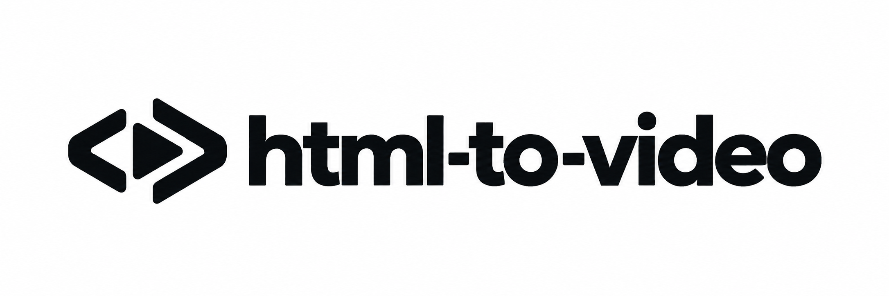

# HTML 视频制作器 · HTML Video Creator

<div align="center">
  <b>中文</b> · <a href="README.en.md">English</a>
</div>

<p align="center">
  
</p>

> **用 HTML 做视频，双击即可播放，逐帧导出 MP4。**
> 面向 AI Agent 的视频制作技能，将需求引导、时间轴动画、音画对齐和导出验收放进一套流程。

[](LICENSE)

[](examples/deepseek-flash-4.1-1017-abyss/demo.mp4)

**DeepSeek 深海鲸鱼演示：60 秒 · 1920×1080 · 60fps · 原创配乐。** 上图为无声片段预览。

[查看完整有声视频](examples/deepseek-flash-4.1-1017-abyss/demo.mp4) · [下载 MP4](https://github.com/AFAP/html-to-video/raw/refs/heads/main/examples/deepseek-flash-4.1-1017-abyss/demo.mp4) · [查看示例源码](examples/deepseek-flash-4.1-1017-abyss) · [分镜与内容说明](examples/deepseek-flash-4.1-1017-abyss/sources.md)

## 1. 它解决了什么问题

让 HTML 动画既能在浏览器里完整播放，也能稳定导出视频。播放、拖动和导出共用 `render(t)`，无需再写一套视频分镜。

```text
需求与素材 → 创作简报 → 分镜与时间轴 → HTML 项目
                                         ├─ 浏览器播放 / 暂停 / 定位
                                         └─ 逐帧 PNG + 音轨 → MP4 → 验收报告
```

## 2. 功能特性

- ✅ 通过简短问题明确受众、时长、画幅、节奏、风格、色系和声音。
- ✅ HTML 可直接双击打开，支持播放、暂停、拖动、重播与全屏。
- ✅ 支持 DOM/CSS、SVG、Canvas 或混合画面，以绝对秒数计算每一帧。
- ✅ 支持 `1920×1080` 横屏与 `1080×1920` 竖屏，每次按需制作一个画幅。
- ✅ 共用画面、音乐与字幕 cue；预览和导出使用同一音轨。
- ✅ 自动执行离线资源检查、乱序定位检查、两秒试导出与全片验收。
- ✅ 缺少 FFmpeg 时由 agent 准备依赖；运行脚本无需安装 npm 包。

## 3. 目录结构

```text
html-to-video/
├── SKILL.md                 # 技能入口与制作规范
├── brand/                   # 黑白字标与彩色方形图标
├── template/                # 可直接播放的项目模板
├── tools/                   # 初始化、检查、导出与验收工具
├── references/              # 渲染接口、音频与故障处理
├── examples/
│   └── deepseek-flash-4.1-1017-abyss/  # 示例源码、音轨、MP4 与预览动图
├── tests/                   # 工具自检
├── README.md                # 中文使用说明
├── README.en.md             # 英文使用说明
└── LICENSE                  # MIT 许可
```

将生成物放在 `output/`，依赖缓存放在 `.cache/`。这两个目录以及其他本地示例不提交到仓库；随附的 `demo.mp4` 和 `preview.gif` 用作演示素材。

## 4. 快速开始

```bash
git clone https://github.com/AFAP/html-to-video.git
cd html-to-video
```

将完整目录导入支持 `SKILL.md` 的 agent 平台，从 [技能入口](SKILL.md) 开始制作。只看示例时，下载仓库后双击 `examples/deepseek-flash-4.1-1017-abyss/index.html`；HTML 播放只需浏览器。

导出需要 Node.js ≥22、Chrome/Edge、FFmpeg 与 ffprobe。先检查环境：

```bash
node tools/doctor.mjs
```

缺少 FFmpeg / ffprobe 时，按 [环境准备](references/troubleshooting.md#环境) 查找或准备便携版，再重跑检查。

## 5. 制作与导出

以下命令在仓库根目录执行。

```bash
node tools/init.mjs my-video --format landscape --fps 30 --duration 30
node tools/check.mjs my-video --format landscape --out output/my-preview
node tools/export.mjs my-video --format landscape --smoke --out output/my-smoke
node tools/export.mjs my-video --format landscape --out output/my-film
node tools/verify.mjs output/my-film
```

1. 初始化后修改 `my-video/project.js`，添加需要的本地素材，并双击 HTML 检查播放。
2. 检查生成的 `sheet.png` 和 `check-report.json`；试听声音并连续播放关键片段。
3. 两秒试导出通过后再导出全片。每次使用新的 `--out` 目录。
4. 确认 `render.json` 的 `status` 为 `complete`、`smoke` 为 `false`，且 `verify-report.json` 的 `ok` 为 `true`，再交付源项目与 MP4。

竖屏项目将初始化、检查和导出命令中的 `--format landscape` 全部改为 `--format portrait`。只制作选定画幅；另一画幅需要重新布局和验收。

## 6. 配置项

| 配置 | 默认值 | 用法 |
| --- | --- | --- |
| `--format` | `landscape` | 选择横屏或 `portrait` 竖屏 |
| `--fps` | `30` | 初始化帧率，可选 `24/25/30/50/60` |
| `--duration` | `8` 秒 | 初始化片长；创建后在 `project.js` 修改 |
| `--crf` / `--preset` | `18` / `medium` | 调整 MP4 编码质量与速度 |
| `--silent` | 关闭 | 明确导出无声版本 |
| `CHROME_PATH` | 自动查找 | 指定 Chrome/Edge 可执行文件 |
| `FFMPEG` / `FFPROBE` | 自动查找 | 指定 FFmpeg 与 ffprobe 可执行文件 |
| `HTML_VIDEO_FFMPEG_DIR` | 自动查找 | 指定 FFmpeg 所在的 `bin` 目录 |

## 7. 排错

| 现象 | 操作 |
| --- | --- |
| HTML 首帧空白或资源缺失 | 检查相对路径、脚本加载顺序及浏览器异常 |
| 跳转后画面不同 | 改用绝对时间计算，固定随机种子，清理跨帧状态 |
| 音轨没有更新 | 重建 `audio.src` 指向的文件，再重新预览和导出 |
| 浏览器或编码器不可用 | 运行 `doctor`，按环境说明准备依赖 |
| 导出中断或目录非空 | 保留报告定位原因，修正后使用新的输出目录 |

完整处理步骤见 [环境与故障定位](references/troubleshooting.md)。

## 8. 安全与素材

工具使用独立的临时浏览器，本地调试端口绑定 `127.0.0.1`；不连接日常浏览器。随项目保存需要的图片、字体与音频，检查自定义脚本后再执行；不要将凭证、私有数据或本机配置放入项目。

示例中的模型介绍为独立作品。DeepSeek 名称与鲸鱼标志属于其权利人；使用说明见 [示例说明](examples/deepseek-flash-4.1-1017-abyss/sources.md#官方鲸鱼标志)，图形代码的上游许可见 [许可原文](examples/deepseek-flash-4.1-1017-abyss/assets/deepseek-harness-LICENSE.txt)。

## 9. 开发与验证

```bash
node --test tests/pipeline.test.mjs
```

运行时负责播放与时间定位，项目脚本负责画面，命令行工具负责截图、合成与验收。共享模块以 `tools/lib-*.mjs` 命名，与命令脚本放在同一目录。修改工具或模板后，执行自检，并在选定画幅上运行 `check` 与两秒试导出。纯 JavaScript 项目无需编译，直接从源码运行。

## 10. 相关文档

- [技能入口与制作规范](SKILL.md)
- [时间驱动的渲染接口](references/rendering-contract.md)
- [音轨、配音与字幕](references/audio.md)
- [环境与故障定位](references/troubleshooting.md)

### 品牌素材


[黑白字标](brand/wordmark.png) · [透明底字标](brand/wordmark-transparent.png)

1:1 透明底图标：[紫蓝渐变](brand/icon-purple-blue.png) · [橙红](brand/icon-orange-coral.png) · [青绿](brand/icon-teal-mint.png) · [宝蓝](brand/icon-electric-blue.png) · [玫红紫](brand/icon-magenta-violet.png) · [琥珀金](brand/icon-amber-gold.png) · [石墨灰与荧光绿](brand/icon-graphite-lime.png)。

## 11. License

[MIT](LICENSE) © 2026 AFAP。第三方素材与商标按各自许可和使用条件处理。
